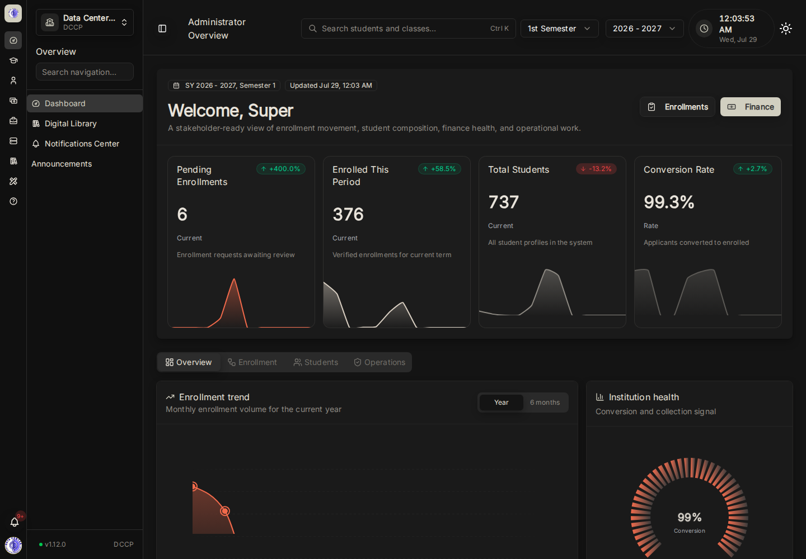
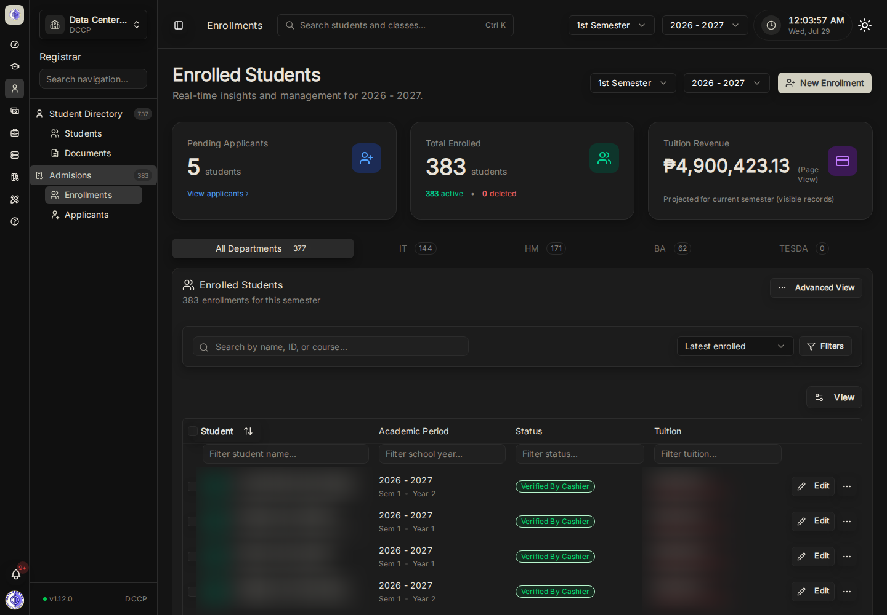
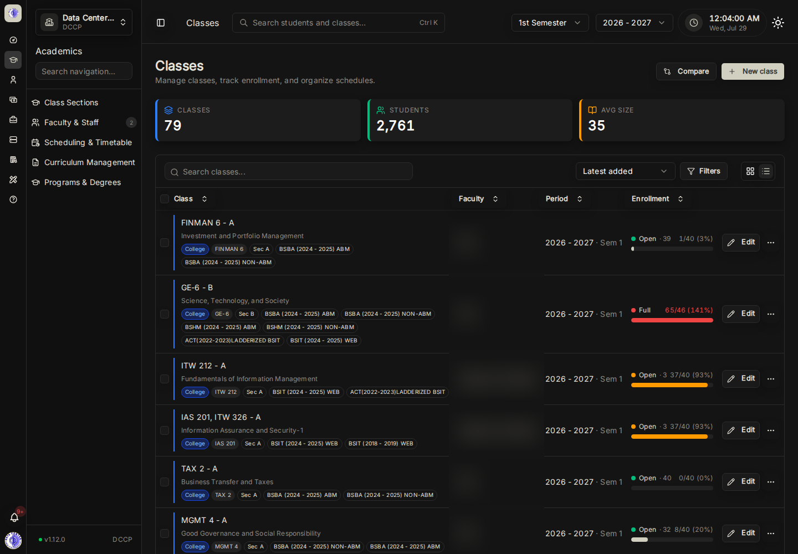
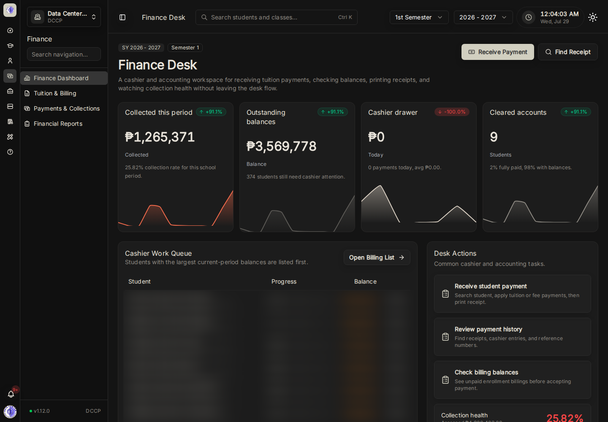
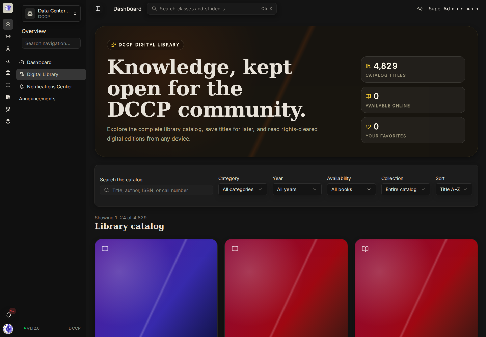

<div align="center">

# 🎓 KoAkademy

**School management that institutions can own — and developers can help shape.**

An open-source, self-hosted platform for enrollment, academics, finance, and day-to-day school operations. Built with real school workflows in mind, starting in the Philippines.

[Explore the project](#what-is-koakademy) · [Run it locally](#try-koakademy-locally) · [View the architecture](#under-the-hood) · [Contribute](#join-the-community)

[](https://github.com/yukazakiri/koakademy/actions/workflows/ci.yml)
[](https://github.com/yukazakiri/koakademy/releases)
[](LICENSE.md)
[](composer.json)
[](composer.json)
[](CONTRIBUTING.md)



</div>

> [!CAUTION]
> **Beta / not production-ready.** KoAkademy is evolving and has [open security, data-integrity, and performance audit findings](https://github.com/yukazakiri/koakademy/issues/440). **Do not expose it to the public internet with real student, staff, health, or financial records until those issues have been resolved and the deployment has been independently reviewed.** Explore with synthetic data in an isolated development or staging environment. See [current limitations](#status-and-limitations) and [security guidance](SECURITY.md).

## What is KoAkademy?

Every school deserves tools it can understand, adapt, and operate without being locked into someone else's pricing or roadmap.

KoAkademy brings essential school workflows into one self-hosted Laravel application. It is designed for administrators, registrars, faculty, and students, while giving developers a real-world codebase to learn from and extend.

**Why build it?** The project began in 2023 as a college feasibility project in the Philippines. Its first version used vanilla PHP; it was rebuilt with Laravel in 2024. Experience with actual school operations shaped the workflows you see here — especially enrollment, registrar processes, and billing.

This is not a claim that one system already fits every institution. It is an invitation to **build more accessible, adaptable school software together**.

### What you can explore

| Area | What KoAkademy includes |
| --- | --- |
| **Enrollment and admissions** | Configurable, versioned enrollment blueprints with eligibility checks, approvals, simulation, staged publication, and rollback. |
| **Academic management** | Students, faculty, courses, programs, classes, schedules, attendance, grading, and reporting. |
| **Role-focused portals** | Administrator, faculty, and student experiences for their daily tasks. |
| **Finance and billing** | Tuition assessment, payment recording, statements, receipts, and reporting. |
| **Optional modules** | Library, inventory, cashier, announcements, notification tools, student medical records, and Forms. |
| **Administration** | Institution branding, role-based access controls, authentication options, and operator-managed infrastructure. |

Features vary in maturity. Treat this as a **codebase to evaluate and improve**, not a fully audited school information system.

### A look inside

<table>
<tr>
<td width="50%"><br><sub><b>Enrollment</b> — applicants, verification, and registrar workflows</sub></td>
<td width="50%"><br><sub><b>Academics</b> — classes, curricula, and schedules</sub></td>
</tr>
<tr>
<td width="50%"><br><sub><b>Finance</b> — assessments, payments, and records</sub></td>
<td width="50%"><br><sub><b>Library</b> — cataloguing and digital reading workflows</sub></td>
</tr>
</table>

## Try KoAkademy locally

**Curious about the project? Start here.** Local development uses SQLite and does not require PostgreSQL, Redis, object storage, or third-party API keys for the basic setup.

**You'll need:** PHP **8.5**, Composer **2**, Node.js **22**, npm, and SQLite support for PHP. See the [development guide](docs/src/content/docs/start-here/development.mdx) for system packages and advanced workflows.

```bash
# Get the source
git clone https://github.com/yukazakiri/koakademy.git
cd koakademy

# Install backend and frontend dependencies
composer install
npm ci

# Create a local environment
cp .env.example .env
php artisan key:generate
touch database/database.sqlite
php artisan migrate

# Build assets and start the application
npm run build
php artisan serve
```

Open **http://127.0.0.1:8000/setup** to initialize a local institution and create its first administrator. Use fictitious data while exploring.

Working on the React interface? Run `npm run dev` in a second terminal for Vite hot reloading. If something doesn't work, check the [development guide](docs/src/content/docs/start-here/development.mdx), search [existing issues](https://github.com/yukazakiri/koakademy/issues), or open a reproducible bug report.

## Under the hood

KoAkademy is a **modular Laravel monolith**, not a collection of separately hosted microservices. The administration panel, React portals, background jobs, and optional modules share an application and authorization model.

| Layer | Technology |
| --- | --- |
| Backend | PHP 8.5, Laravel 13, Filament 5 |
| Frontend | React 19, TypeScript, Inertia v3, Vite 8 |
| Production data | PostgreSQL, Redis |
| Documents and storage | Gotenberg, local volumes or S3-compatible object storage |
| Deployment | Docker, nginx/PHP-FPM or FrankenPHP; documented Docker Swarm and Compose configurations |
| Testing and quality | Pest 5, Laravel Pint, frontend builds, GitHub Actions |

```text
app/           Laravel services, models, policies, jobs, and controllers
resources/js/  React/Inertia portals and shared UI
Modules/       Optional school-operation modules
database/      Migrations, factories, and seeders
routes/        HTTP, API, and other route definitions
tests/         Automated tests
docker/        Container and runtime assets
docs/          Guides for developers, operators, and school staff
```

To go deeper, read the [architecture guide](docs/src/content/docs/start-here/architecture.mdx), [enrollment blueprint overview](docs/src/content/docs/enrollment-policies/overview.mdx), and [documented API surface](docs/src/content/docs/api/api-overview.mdx).

## Self-hosting and operations

KoAkademy aims to give institutions control of their deployment, database, backups, and upgrade schedule. **Self-hosted does not mean maintenance-free or cost-free**: hosting, storage, email, monitoring, recovery, and security remain the operator's responsibility.

The documented Linux installer provisions a **single-node Docker Swarm** setup with Caddy HTTPS, a private application service, PostgreSQL, Redis, and Gotenberg. Manual Docker Compose deployment is also documented.

**For now, use an isolated staging environment only.** Review [installation instructions](docs/src/content/docs/self-hosting/installation.mdx), [deployment and backup guidance](docs/src/content/docs/self-hosting/deployment.mdx), and the [latest release artifacts](https://github.com/yukazakiri/koakademy/releases) before attempting an installation. Installer scripts require elevated host privileges: inspect any downloaded script before running it.

## Status and limitations

We would rather be transparent about what's unfinished than surprise a school or contributor later.

| Limitation | What it means today |
| --- | --- |
| **Beta quality and breaking changes** | Workflows, data models, and integrations can change. Upgrades require staging tests and backups; pre-v2 compatibility is not guaranteed. |
| **Unresolved audit findings** | [Tracked security, database, and performance issues](https://github.com/yukazakiri/koakademy/issues/440) include potentially serious risks around access control, data exposure, financial records, and migrations. **Not suitable for real institutional data in its current state.** |
| **Philippine-first workflows** | Enrollment, grading, finance, and registrar conventions were designed around Philippine institutions. Other countries and school systems will likely need changes. |
| **Limited regulatory providers** | CHED E-Form B/C is the built-in reporting provider; other jurisdictions need their own adapters. |
| **Small, evolving public API** | Only [documented endpoints](docs/src/content/docs/api/api-overview.mdx) are part of the beta contract. A general student CRUD API is not guaranteed. |
| **Optional modules require installation** | Modules are distributed through Composer. The module catalogue and Marketplace do not automatically install packages into a running deployment. |
| **No built-in high availability** | The default installer is single-node. It is not a multi-node failover solution, and recovery depends on tested backups and operator procedures. |
| **Specific toolchain** | Development currently targets PHP 8.5 and Node.js 22. Earlier PHP versions are not supported by the declared dependency constraints. |
| **Volunteer maintenance** | Support, issue response, and releases are best-effort, without guaranteed turnaround times or an SLA. |

Check [open issues](https://github.com/yukazakiri/koakademy/issues) and [release notes](https://github.com/yukazakiri/koakademy/releases) for the latest state. If you find a vulnerability, **do not publish an exploit or sensitive data in an issue**; follow [SECURITY.md](SECURITY.md).

## Join the community

**You do not have to build a whole school feature to make a difference.** A clear bug report, a failing test, a corrected setup step, or a more accessible UI can help the next developer — and, eventually, the schools that depend on this kind of software.

Good places to start:

- **Try the local setup** and tell us what was confusing.
- **Improve tests and fix bugs**, especially in authorization, data integrity, and enrollment workflows.
- **Polish the interface**, documentation, accessibility, or developer experience.
- **Help make the platform adaptable** to more schools, languages, and regulatory requirements.

Before a substantial change, read [CONTRIBUTING.md](CONTRIBUTING.md), check [issues](https://github.com/yukazakiri/koakademy/issues), and discuss your approach with the maintainers. Please use synthetic data in tests and bug reports.

A useful local validation starting point:

```bash
vendor/bin/pint --test
php artisan test --parallel --compact
npm run build
npm run docs:check
```

Thank you for considering a contribution. **One thoughtful improvement at a time is how this project gets better.** 💚

## Documentation and help

| Looking for... | Start here |
| --- | --- |
| Local setup and code conventions | [Development guide](docs/src/content/docs/start-here/development.mdx) |
| Contribution workflow and checks | [Contributing](CONTRIBUTING.md) |
| Application architecture | [Architecture](docs/src/content/docs/start-here/architecture.mdx) |
| Server setup, backups, and upgrades | [Installation](docs/src/content/docs/self-hosting/installation.mdx) · [Deployment](docs/src/content/docs/self-hosting/deployment.mdx) |
| Enrollment rules | [Enrollment blueprints](docs/src/content/docs/enrollment-policies/overview.mdx) |
| Supported integrations | [API overview](docs/src/content/docs/api/api-overview.mdx) |
| Responsible vulnerability reports | [Security policy](SECURITY.md) |

## License

KoAkademy is released under the **[GNU Affero General Public License v3.0 or later](LICENSE.md)** (AGPL-3.0-or-later).

You may study, use, modify, and share the project under the license's terms. If you operate a modified version over a network, the AGPL includes obligations to offer the corresponding source code to its users. Read the [full license](LICENSE.md) for details.

---

<div align="center">

**Built for schools. Open to developers. Better with a community.**

If KoAkademy sparks an idea, try it locally, open an issue, or contribute a pull request. If you'd like to support its visibility, consider starring the repository. ⭐

</div>
