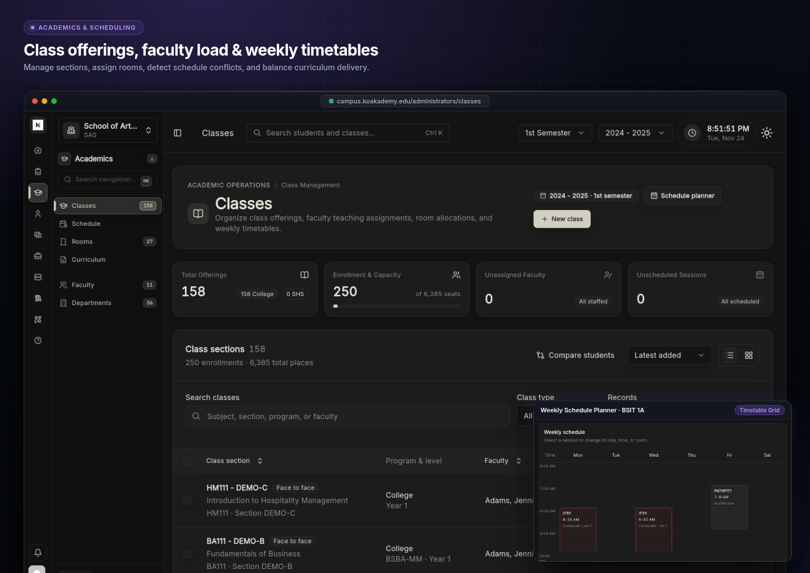

# Academics, Curricula & Timetabling

Koakademy provides an academic scheduling and curriculum engine designed to handle diverse institutional models—from secondary K-12 Senior High School tracks to multi-tiered collegiate degree programs and technical certificate courses.



---

## Academic Hierarchy

```
┌────────────────────────────────────────────────────────┐
│                        School                          │
└───────────────────────────┬────────────────────────────┘
                            │
              ┌─────────────┴─────────────┐
              ▼                           ▼
┌───────────────────────────┐ ┌───────────────────────────┐
│     Basic Education       │ │     Higher Education      │
│  (Junior & Senior High)   │ │  (Colleges & Departments) │
└─────────────┬─────────────┘ └─────────────┬─────────────┘
              │                             │
       ┌──────┴──────┐               ┌──────┴──────┐
       ▼             ▼               ▼             ▼
┌─────────────┐┌─────────────┐ ┌─────────────┐┌─────────────┐
│  SHS Track  ││ SHS Strand  │ │  Department ││   Program   │
│ (e.g. TVL)  ││ (e.g. ICT)  │ │ (e.g. CITE) ││  (e.g. BSIT)│
└──────┬──────┘└──────┬──────┘ └──────┬──────┘└──────┬──────┘
       │              │               │              │
       └──────┬───────┘               └──────┬───────┘
              ▼                              ▼
┌───────────────────────────┐ ┌───────────────────────────┐
│     Strand Curriculum     │ │     Degree Curriculum     │
└─────────────┬─────────────┘ └─────────────┬─────────────┘
              │                             │
              └──────────────┬──────────────┘
                             ▼
┌────────────────────────────────────────────────────────┐
│                        Subjects                        │
│   (Lecture Units, Lab Units, Hours, Pre/Co-reqs)       │
└────────────────────────────┬───────────────────────────┘
                             ▼
┌────────────────────────────────────────────────────────┐
│                     Class Offerings                    │
│   (Sections, Room Allocation, Timetable, Faculty Load) │
└────────────────────────────────────────────────────────┘
```

---

## Programs, Curricula & Tracks

### Higher Education Degree Programs
Collegiate curricula in Koakademy are structured around academic departments and regulatory program standards:
- **Credit Units & Clock Hours:** Each subject explicitly differentiates between lecture credit units, laboratory credit units, lecture contact hours, and laboratory contact hours.
- **Year Level & Term Mapping:** Subjects are organized by year level (1st through 5th Year) and academic term (Semester, Trimester, or Summer Session).
- **Prerequisite Chains:** Enforces linear or branched prerequisite requirements. A student cannot enroll in *Data Structures and Algorithms* without successfully passing *Computer Programming 2*.
- **Co-requisite Bundling:** Enforces simultaneous enrollment in linked courses (e.g., enrolling in *Organic Chemistry Lecture* mandates simultaneous enrollment in *Organic Chemistry Laboratory*).
- **Major Specializations:** Programs can define common core foundations followed by specialized major tracks in later years.

### Senior High School (SHS) Tracks & Strands
Koakademy natively implements the Department of Education (DepEd) K-12 Senior High School framework:
- **Academic Track:** STEM (Science, Technology, Engineering, and Mathematics), ABM (Accountancy, Business, and Management), HUMSS (Humanities and Social Sciences), and GAS (General Academic Strand).
- **TVL Track:** Technical-Vocational-Livelihood specializations, including Information and Communications Technology (ICT), Home Economics (HE), and Agri-Fishery Arts.
- **Subject Classifications:** Distinguishes between **Core Subjects** (common to all SHS students), **Applied Subjects** (contextualized across tracks), and **Specialized Subjects** (exclusive to a chosen strand).

---

## Timetable Scheduling & Automated Conflict Detection

Koakademy replaces manual timetable spreadsheets with an interactive visual scheduler (`Timetable.php` and `AdministratorSchedulingAnalyticsController`).

```
┌──────┬──────────────────────┬──────────────────────┬──────────────────────┐
│ Time │      Room 101        │      Lab 302         │      Gymnasium       │
├──────┼──────────────────────┼──────────────────────┼──────────────────────┤
│ 8:00 │ BSIT 1-A (Prof. Cruz)│ BSCS 2-B (Prof. Lim) │                      │
│ 9:00 │ CS 101 Lecture       │ IT 204 Web Lab       │                      │
├──────┼──────────────────────┼──────────────────────┼──────────────────────┤
│10:00 │ [ CONFLICT BLOCKED ] │                      │ PE 101 (Prof. Santos)│
│11:00 │ Room Already Booked  │                      │ Section 1-A & 1-B    │
└──────┴──────────────────────┴──────────────────────┴──────────────────────┘
```

### Automated Conflict Prevention
When an administrator or department chair assigns a class schedule, the system performs instantaneous constraint checks across three dimensions:

1. **Room Collisions:** Prevents scheduling two classes in the same physical or virtual room at overlapping times on identical days.
2. **Faculty Overlapping Loads:** Prevents assigning a professor to teach two distinct classes at the same time, calculating real-time faculty teaching units against institutional maximum overload caps.
3. **Student Section Clashes:** Validates that mandatory subjects assigned to a block section do not overlap, guaranteeing students a friction-free schedule.

### Facilities & Room Capacity
- **Room Types:** Classrooms, lecture halls, computer laboratories, science laboratories, drawing studios, and audio-visual rooms.
- **Capacity Gates:** Prevents class section enrollments from exceeding the physical seating capacity of the assigned classroom.

---

## Schedule Changes & Student Notifications

In live operations, room reassignments, faculty substitutions, and class schedule adjustments are inevitable:

- **Schedule Change Log (`ClassScheduleChange`):** Every timetable modification is recorded with the previous schedule, new schedule, authorized reason, and acting user.
- **Automated Student Broadcasts (`ClassScheduleChangeStudentNotification`):** When a schedule change is approved, affected students receive immediate in-app notifications, mobile alerts, and updated timetable views.
- **Calendar Synchronization:** Students and faculty can subscribe to live iCal calendar feeds or sync their schedules directly with Google Calendar. Schedule changes update in personal calendars automatically.
