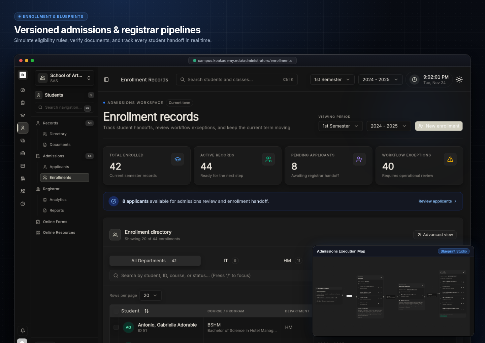

# Enrollment Management & Policy Engine

Koakademy replaces rigid, hardcoded enrollment rules with **Enrollment Blueprints**—a declarative, visual policy compiler that gives institutions complete flexibility over admission windows, academic eligibility, fee structures, and approval workflows.



---

## The Seven-Stage Guided Builder

```
┌──────────┐   ┌──────────┐   ┌──────────┐   ┌──────────┐
│ 1. Scope │──▶│ 2. Window│──▶│3. Require│──▶│4. Billing│
│ & School │   │ & Dates  │   │  & Checks│   │ & Tuition│
└──────────┘   └──────────┘   └──────────┘   └────┬─────┘
                                                  │
               ┌──────────┐   ┌──────────┐        │
               │7. Rollout│◀──│6. Verify │◀───────┘
               │& Activate│   │ & Simulate│
               └──────────┘   └──────────┘
```

1. **Scope & Inheritance:** Target a policy globally, or inherit from a parent blueprint while applying sparse overrides to specific schools, degree programs, or student types (e.g., Freshmen, Transferees, Returnees).
2. **Availability Windows:** Define strict opening and closing dates and times for online enrollment portals, walk-in admissions, and late registration periods.
3. **Eligibility & Document Requirements:** Specify mandatory academic requirements (e.g. minimum GWA, prerequisite completion) and required document uploads (PSA Birth Certificate, Form 137, Good Moral Certificate).
4. **Subjects, Classes & Tuition:** Configure subject assignment models (Fixed Block Section vs. Free Subject Selection), per-unit lecture rates, laboratory fees, and institutional charges.
5. **Approval Workflows:** Construct safe acyclic review sequences involving Registrars, Department Deans, and Cashiers.
6. **Journey Simulation:** Run automated simulations against sample student profiles to verify that prerequisites, fee calculations, and approval gates resolve correctly.
7. **Publication & Activation:** Publish an immutable, cryptographically hashed policy snapshot and activate it across targeted institutional scopes.

---

## Automated Eligibility & Prerequisite Engine

During enrollment, Koakademy's rule engine evaluates every student journey against active policy criteria in real time:

- **Academic Standing Verification:** Evaluates cumulative GWA against program retention policies. Students on academic probation are automatically redirected to academic advising before subject registration.
- **Automated Prerequisite Checks:** Prevents subject selection if the required prerequisite course has not received a passing grade in the student's historical transcript.
- **Maximum Unit Overload Controls:** Enforces maximum semester credit unit caps (e.g., 24 units maximum) unless an approved overload permit is recorded in the student's profile.
- **Clearance Gate Integration:** Instantly flags active financial, library, or disciplinary holds, preventing final enrollment submission until all holds are cleared.

---

## Dynamic Fee Calculation

The billing compiler calculates student assessments down to the centavo without manual staff intervention:

```txt
Total Assessment = (Lecture Units × Rate_lec) + (Lab Units × Rate_lab) + Assessed Fees - Discounts
```

- **Lecture vs. Laboratory Pricing:** Distinct per-unit hourly rates for classroom lectures versus hands-on laboratory subjects.
- **Automatic Discount Rules:** Evaluates sibling discounts (e.g., 10% off tuition for second child), academic honor scholarships (e.g., 100% tuition waiver for Valedictorian), and athletic grants.
- **Installment Plan Schedules:** Generates customized installment breakdowns (Downpayment, Prelims, Midterms, Prefinals, Finals) with clear due dates and minimum enrollment downpayment gates.

---

## Acyclic Approval Timelines

Koakademy guarantees that enrollment workflows are strictly acyclic—preventing infinite approval loops or deadlock states:

```
┌─────────────────┐
│ Student Submits │
│  Registration   │
└────────┬────────┘
         │
         ▼
┌─────────────────┐     [Incomplete Docs]     ┌─────────────────┐
│    Registrar    │ ────────────────────────▶ │ Returned with   │
│   Evaluation    │                           │ Specific Note   │
└────────┬────────┘                           └─────────────────┘
         │ [Approved]
         ▼
┌─────────────────┐     [Overload Needed]     ┌─────────────────┐
│ Department Dean │ ────────────────────────▶ │ Dean Review &   │
│  Subject Review │                           │ Overload Waiver │
└────────┬────────┘                           └────────┬────────┘
         │ [Approved]                                  │
         ▼                                             │
┌─────────────────┐ ◀──────────────────────────────────┘
│ Cashier Payment │
│   & Validation  │
└────────┬────────┘
         │ [Paid / Cleared]
         ▼
┌─────────────────┐
│ Officially      │
│ Enrolled State  │
└─────────────────┘
```

- **Conditional Branching:** Steps activate only when relevant criteria are met (e.g., Dean approval is only triggered if the student requests a course overload or cross-enrollment).
- **Fallback Reviewers:** If a primary reviewer is unavailable, requests automatically escalate to designated secondary roles after a configurable timeout.
- **Instant Student Feedback:** Students receive live timeline progress updates in the Student Portal as each reviewer signs off.

---

## Rollout States & Snapshot Safety

To protect operational integrity during active semesters, Koakademy enforces an immutable versioning contract:

- **Policy Snapshots (`EnrollmentPolicySnapshot`):** When a student completes enrollment, their assessment and subject line-up are pinned to a permanent snapshot.
- **Non-Destructive Adjustments:** Adjusting tuition rates or curriculum rules mid-semester generates a new policy version for future terms without mutating existing enrolled students' historical financial obligations.
- **One-Click Rollback:** In the event of an erroneous policy release, administrators can instantly revert to a previous verified version without data loss.
