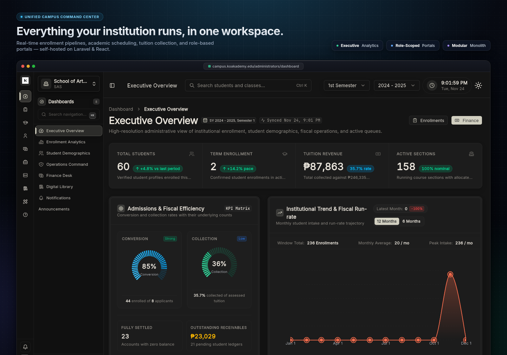

# Platform Features Overview

Koakademy is an open-source, all-in-one educational ERP, student information system (SIS), and learning management platform. It gives private and public educational institutions complete ownership over student records, academic scheduling, enrollment automation, tuition billing, and daily school operations.



```
┌────────────────────────────────────────────────────────────────────────┐
│                        Koakademy Platform                              │
└──────────────────────────────────┬─────────────────────────────────────┘
                                   │
         ┌─────────────────────────┼─────────────────────────┐
         ▼                         ▼                         ▼
┌──────────────────┐     ┌──────────────────┐     ┌──────────────────┐
│ Administrative   │     │ Faculty Portal   │     │ Student Portal   │
│ Workspace        │     │ (Inertia + React)│     │ (Inertia + React)│
│ (Filament 5)     │     │                  │     │                  │
└────────┬─────────┘     └────────┬─────────┘     └────────┬─────────┘
         │                        │                        │
         └────────────────────────┼────────────────────────┘
                                  ▼
┌────────────────────────────────────────────────────────────────────────┐
│                     Core Domain Engine & Services                      │
│                                                                        │
│  • Student Information System (SIS)  • Academic Curricula & Timetable  │
│  • Dynamic Enrollment Blueprints     • Multi-Scale Grading & GWA       │
│  • Automated Tuition & Cashiering    • Six Bundled Specialized Modules │
│  • Cryptographic Verifications       • AI Assistant & MCP Server       │
└────────────────────────────────────────────────────────────────────────┘
```

## Institutional Coverage

Koakademy natively accommodates different educational levels and regulatory frameworks within a single deployment or across multiple federated campuses:

| Institution Level | Regulatory Framework | Specialized Capabilities Included |
| ----------------- | -------------------- | --------------------------------- |
| **Senior High School (SHS)** | DepEd (K-12) | Academic & TVL tracks, strands (STEM, ABM, HUMSS, GAS, ICT, HE), strand-specific subject matrices, semester and quarterly terms. |
| **Colleges & Universities** | CHED | Degree programs, majors, lecture vs. laboratory credit unit calculations, prerequisites, co-requisites, year levels, Latin honors computation. |
| **Technical-Vocational** | TESDA / TVET | Competency-based qualifications, certificate courses, modular training batches, assessment export sheets. |
| **Multi-School Campus Networks** | Federated Multi-Tenancy | Isolated school organizations with shared infrastructure, cross-campus role assignments, and instant tenant switching. |

---

## Feature Matrix

### 1. Student Lifecycle & Records (SIS)
- **Comprehensive Student Profiles:** Personal details, civil status, PSA birth certificate records, complete Philippine standard geographic code (PSGC) address hierarchies (Region, Province, City/Municipality, Barangay), and contact numbers.
- **Family & Guardian Information:** Parent and emergency contact profiles, income tiers, and relationship records.
- **Prior Education History:** Historical schools attended, year graduated, LRN (Learner Reference Number), and entrance credentials.
- **Digital Student ID Cards:** High-fidelity student identification cards generated server-side with customizable layout, student photo, barcodes, and cryptographically signed QR codes.
- **Public & Authenticated Verification:** QR verification endpoints to instantaneously validate enrollment status, student authenticity, and ID validity.
- **Student Clearance Workflows:** Departmental clearance sign-offs (Library, Cashier, Clinic, Guidance, Prefect of Discipline) with automated clearance hold restrictions.
- **Status History & ID Change Audit:** Immutable historical ledger tracking status changes (Active, Enrolled, LOA, Dropped, Graduated, Expelled) and student number revisions.

### 2. Academics, Curricula & Timetabling
- **Curriculum & Program Builder:** Structured academic programs mapped by year level and semester, complete with lecture units, laboratory units, prerequisite chains, and co-requisites.
- **Spreadsheet Imports:** Bulk curriculum ingestion supporting standardized CSV and Excel import templates with validation feedback.
- **Class Section Management:** Capacity caps, automatic seat reservation, and section cloning across academic terms.
- **Timetable Scheduling & Conflict Detection:** Interactive weekly schedule view with automated conflict prevention across classrooms, faculty loading, and student schedules.
- **Facility & Room Allocation:** Building, floor, room capacities, and specialized facility assignments (Computer Labs, Science Labs, Auditoriums).
- **Calendar Feeds:** Subscribable iCal and Google Calendar sync for student schedules and faculty timetables.

### 3. Enrollment Blueprints & Automation
- **Guided Blueprint Engine:** Seven-stage guided configuration defining school scopes, availability dates, admission requirements, subject pricing, and approval sequences.
- **Dynamic Rule Engine:** Rule evaluation assessing minimum GWA, prerequisite completion, document submissions, and clearance holds without hardcoded logic.
- **Lecture vs. Laboratory Pricing:** Automated tuition assessment supporting distinct per-unit lecture rates, lab rates, program fees, and institutional charges.
- **Scholarship & Discount System:** Automatic sibling discounts, academic honor discounts, athletic grants, and custom percentage or fixed-amount vouchers.
- **Acyclic Approval Workflows:** Configurable multi-step approval paths (Registrar -> Dean -> Cashier -> Enrolled) with conditional branching and fallback reviewers.
- **Journey Simulator:** Risk-free policy testing allowing registrars to simulate a sample student journey before activating a policy version.
- **Rollout States & Snapshots:** Immutable policy versioning preventing retro-active changes to active enrollments while allowing smooth policy rollbacks.

### 4. Grading, Transcripts & Academic Honors
- **Configurable Grading Policies:** Support for numeric (1.0 to 5.0), percentage (0% to 100%), letter grades (A through F), and Pass/Fail rubrics.
- **Grade Submission Periods:** Scheduled grading windows with countdown timers, automated locking, and formal change-of-grade request workflows.
- **General Weighted Average (GWA):** Real-time weighted average calculation with configurable rules for including or excluding specific subject categories (e.g. NSTP, PE, Religious Education).
- **Official Transcript of Records (TOR):** Server-rendered PDF transcripts with security watermarks, registrar signature blocks, and grade verification hashes.

### 5. Financial Management, Billing & Cashiering
- **Tuition Fee Assessment:** Automated tuition computation upon subject selection, itemizing tuition, miscellaneous fees, and laboratory charges.
- **Installment Payment Schemes:** Configurable payment plans (Full cash, Prelim-Midterm-Prefinal-Final installments) with downpayment gates.
- **Statements of Account (SOA):** Instant PDF statement generation complete with balance ledgers, transaction history, and cryptographic validation hashes.
- **Cashier POS Interface:** Streamlined counter interface for receiving cash, cheque, bank transfer, and online payments with instantaneous Official Receipt (OR) issuance.
- **Tuition Adjustments & Vouchers:** Formal adjustment requests and bulk tuition credit/debit spreadsheet imports with approval verification.
- **Financial Analytics & Exports:** Daily collection logs, aging balances, and student accounts exportable to Microsoft Excel and PDF.

### 6. Purpose-Built Workspaces
- **Administrative Workspace (Filament 5):** Unified management panel for registrars, deans, finance officers, and system administrators with role-scoped navigation and widgets.
- **Faculty Portal (Inertia 3 + React 19):** Modern, responsive portal for teaching staff to manage assigned classes, mark attendance, post announcements, receive student assignments, and encode grades.
- **Student Portal (Inertia 3 + React 19):** Mobile-first progressive web application for students to view weekly timetables, track tuition balances, download SOAs, view grade cards, access digital IDs, and receive push notifications.

### 7. Bundled Specialized Modules
- **Announcements Module:** School-wide, role-targeted, and department-specific bulletin board with banner render hooks.
- **Cashiering Module:** Dedicated cashier register workflow with daily drawer balancing and transaction reconciliation.
- **Inventory & Asset Management:** Campus equipment ledger, room tracking, asset amortization, supplier directory, and custodian assignments.
- **Library Management System:** Book cataloging, ISBN lookup, borrowing/returning ledger, overdue fines, and digital research paper archives.
- **Notification Center:** Template-driven transactional messaging across email, in-app notifications, and batch broadcast queues.
- **Student Medical Records:** Confidential clinic visit notes, student health profiles, medical clearances, and prescription logs with HIPAA-grade privacy isolation.

### 8. Security, AI & Integrations
- **Authentication:** Passwordless WebAuthn passkeys, TOTP 2FA apps, email OTP, magic links, and Google/Microsoft OAuth via Socialite.
- **Role-Based Access Control (RBAC):** Over 30 granular roles governed by Filament Shield and spatie/laravel-permission with model policy enforcement.
- **Observability:** Integrated developer tools including Laralyze, Laravel Pulse, Telescope, Horizon queue monitors, and automated log retention cleanup.
- **Model Context Protocol (MCP) Server:** Standardized MCP endpoint allowing AI agents (Claude Desktop, Delta, Cursor) to safely read and operate school records via authorized tools.
- **Gotenberg PDF Engine:** High-performance, vector-crisp server-side document rendering powered by headless Chromium.
