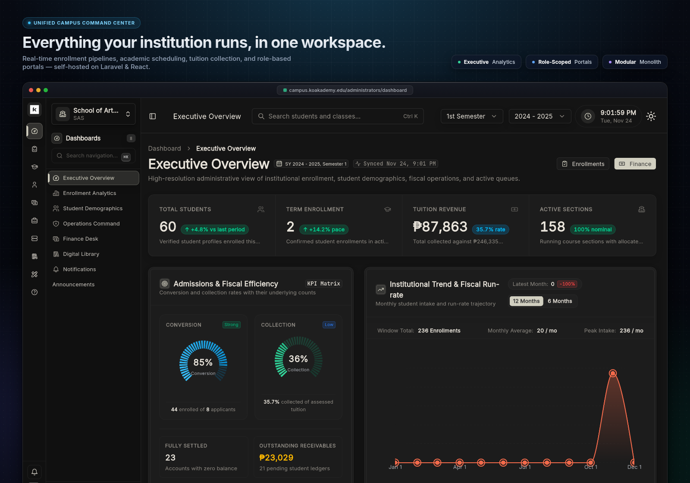
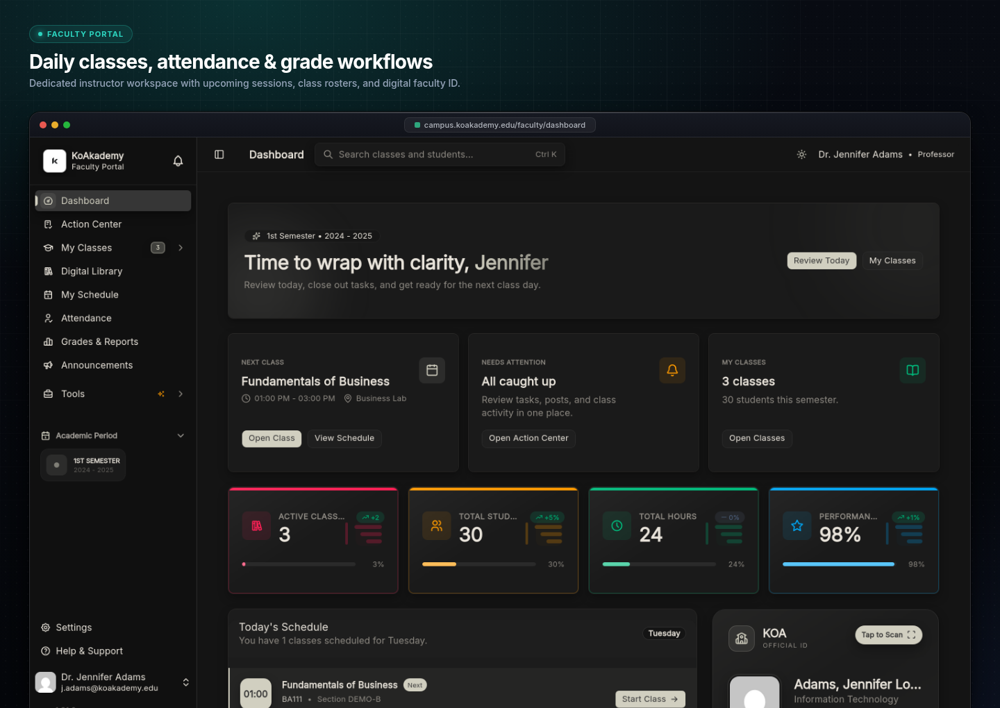
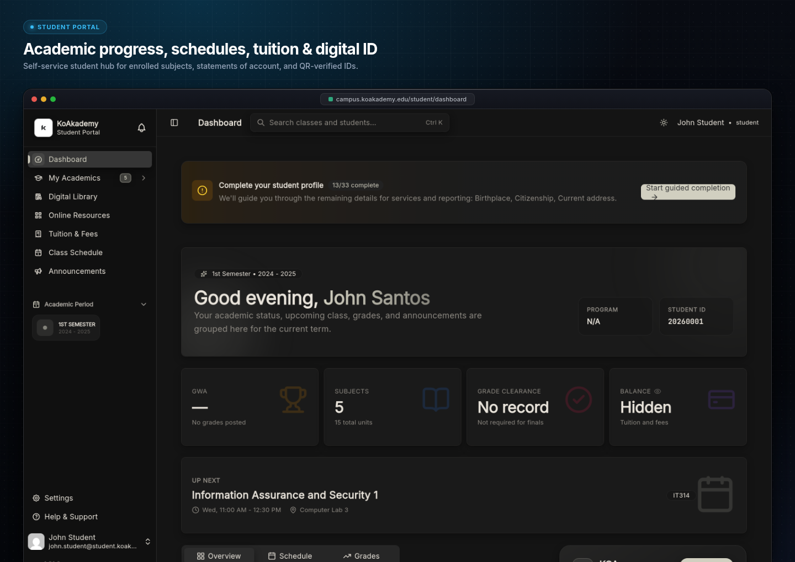

# Portals & User Workspaces

Koakademy provides three distinct, role-optimized user interfaces rather than a single monolithic portal. Each workspace is tailored to the workflows, device form factors, and security needs of its intended audience.

---

## 1. Administrative Workspace (`/admin`)

Built on **Filament 5**, the Administrative Workspace is the mission-control center for School Administrators, Registrars, Department Chairs, Cashiers, and System Maintainers.



```
┌────────────────────────────────────────────────────────┐
│ [LOGO] Koakademy Admin         [Org Switcher: Main]    │
├───────────────┬────────────────────────────────────────┤
│ Navigation    │ Dashboard                              │
│ • Dashboard   │ ┌────────────┐┌────────────┐┌─────────┐│
│ • Academic    │ │ Total Enr. ││ Outstanding││ Classes ││
│ • Students    │ │ 4,821      ││ ₱1.2M      ││ 246     ││
│ • Enrollment  │ └────────────┘└────────────┘└─────────┘│
│ • Finance     │ Quick Actions                          │
│ • Faculty     │ [ + Enroll Student ] [ + New Section ] │
│ • Settings    │                                        │
│ • Modules     │ Recent Registrations Table             │
└───────────────┴────────────────────────────────────────┘
```

### Key Capabilities
- **Role-Scoped Navigation:** Over 30 granular roles (governed by Filament Shield) ensure registrars only see academic records, cashiers only see billing/collections, and system admins see infrastructure tools.
- **Organization Switcher:** Instantly switch between branch campuses or school divisions without logging out.
- **Bulk Spreadsheet Tools:** Import students, curricula, faculty loading sheets, and tuition adjustments directly from Excel templates.
- **Audit Log Inspection:** Full chain-of-custody tracking showing who edited records, with IP addresses and before/after JSON diffs.

---

## 2. Faculty Portal (`/faculty`)

Built with **Inertia 3 and React 19**, the Faculty Portal provides teaching staff with a fast, modern single-page application for managing their classroom duties.



```
┌────────────────────────────────────────────────────────┐
│ Koakademy Faculty       [AY 2026-2027, 1st Sem] [User] │
├────────────────────────────────────────────────────────┤
│ My Classes                                             │
│ ┌───────────────────────┐  ┌─────────────────────────┐ │
│ │ CS 101 - Section A    │  │ IT 204 - Section B       │ │
│ │ MWF 8:00 AM - Room 101│  │ TTh 1:00 PM - Lab 302    │ │
│ │ Enrolled: 38/40       │  │ Enrolled: 32/35          │ │
│ │ [ Attendance ] [Grade]│  │ [ Attendance ] [Grade]   │ │
│ └───────────────────────┘  └─────────────────────────┘ │
│                                                        │
│ Action Center                                          │
│ • 4 Pending assignment submissions in IT 204           │
│ • Midterm grading deadline in 3 days                   │
└────────────────────────────────────────────────────────┘
```

### Key Capabilities
- **Interactive Attendance Sheet:** Mark students Present, Late, Absent, or Excused with a single tap. Summarizes attendance percentages and flags attendance risks automatically.
- **Gradebook & Finalization:** Enter prelim, midterm, and final marks with auto-calculated weighted averages. One-click submission locks grades and notifies department chairs.
- **Class Feed & Announcements:** Post lecture notes, homework guidelines, and syllabus updates directly to enrolled students.
- **Student Submission Ingestion:** Accept digital assignments, track late submissions, and return teacher feedback.

---

## 3. Student Portal (`/student`)

Built with **Inertia 3, React 19, and Tailwind CSS 4**, the Student Portal is a responsive, mobile-first progressive web application (PWA) designed for students on smartphones and tablets.



```
┌──────────────────────────────────────┐
│  JUAN DELA CRUZ           [ID CARD]  │
│  BS Information Technology           │
├──────────────────────────────────────┤
│  TODAY'S SCHEDULE                    │
│  ┌─────────────────────────────────┐ │
│  │ CS 101 - Introduction to CS     │ │
│  │ 8:00 AM - 10:00 AM  •  Room 101 │ │
│  └─────────────────────────────────┘ │
│  ┌─────────────────────────────────┐ │
│  │ IT 204 - Web Systems Lab        │ │
│  │ 1:00 PM - 4:00 PM  •  Lab 302   │ │
│  └─────────────────────────────────┘ │
│                                      │
│  FINANCIAL OVERVIEW                  │
│  Outstanding Balance: ₱4,500.00      │
│  Next Due Date: Oct 25 (Midterm)     │
│  [ View Full Statement ]             │
│                                      │
│  QUICK ACCESS                        │
│  [ Grades ] [ Timetable ] [ Clearance│
└──────────────────────────────────────┘
```

### Key Capabilities
- **Visual Timetable:** A clear, color-coded weekly schedule showing start/end times, room locations, and professor names.
- **Financial Account Overview:** Live ledger showing assessed tuition, posted payments, current balances, and downloadable Statement of Account PDFs.
- **Academic Grade Cards:** Real-time visibility into midterm and final grades as soon as they are approved by the registrar.
- **Digital ID Card:** Instant access to the mobile student ID with QR verification token for campus gate entry and library borrowing.
- **Clearance Tracker:** Live departmental clearance status highlighting any active library, cashier, or departmental holds.
